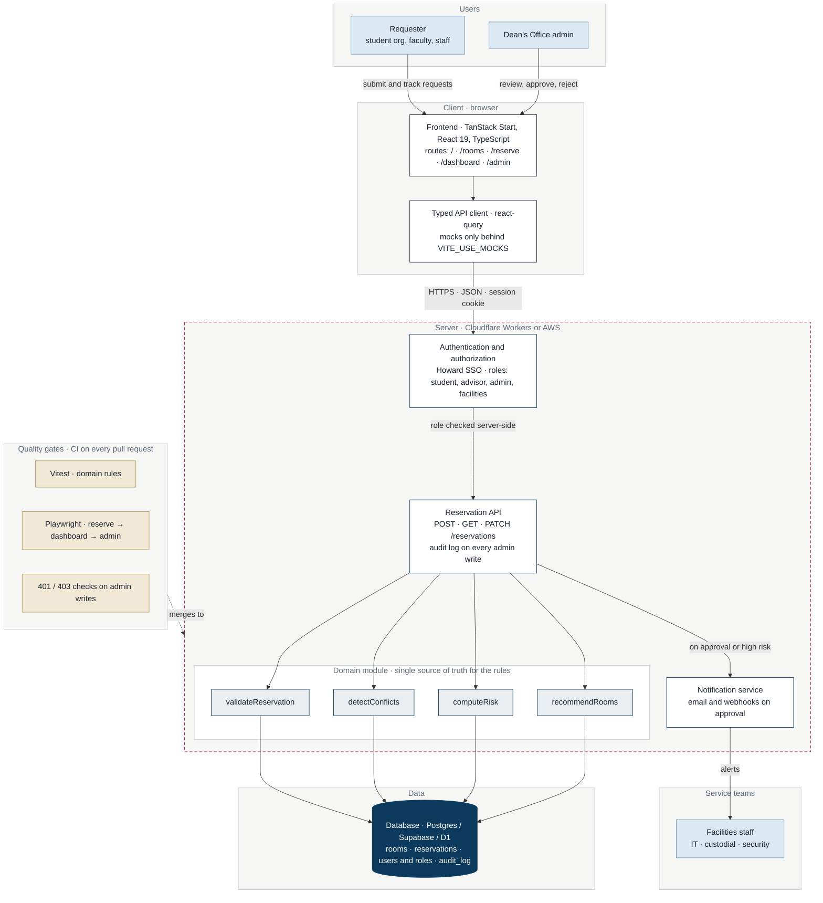

# Backend Builders

**CEA Event Space Reservation System**

## 🚀 Overview

Our team, The Backend Builders, built a web-based event reservation and decision support system designed for the College of Engineering and Architecture at Howard University.

The platform transforms a manual, form-based reservation process into an intelligent system that validates requests in real time, assists users during event planning, and helps administrators efficiently manage approvals and campus resources.

## 🔗 Preview

Group 2 project link:  
https://id-preview--4f0e361e-9ccb-4f09-b180-76f38ef45d33.lovable.app/

## ❗ Problem

The existing reservation process relies on manual review and coordination across multiple departments. This leads to:

- Delays in event approvals
- Inefficient communication between offices
- Risk of missing safety or policy requirements
- Poor visibility into space usage and demand

The system collects information but does not assist in decision making.

## 💡 Solution

This project introduces an intelligent reservation system that:

- Validates event details in real time
- Checks room availability before submission
- Recommends rooms based on attendance
- Flags high-risk conditions (large events, outside guests, after hours)
- Notifies IT, custodial, and security services automatically
- Provides an admin dashboard for streamlined approvals

## 🧱 Architecture

**Current state.** The app today is a front-end prototype that runs entirely in the browser. Rooms and requests come from static mock data in `src/lib`, and submissions and approvals are kept in page state, so they are lost on refresh. There is no backend API, database, login, or test suite yet. See the [Project Reset Report](docs/project-reset-report.pdf) for the full assessment.

**Target architecture (planned).** The diagram below is the design the backlog delivers. Users sign in, the frontend talks to a reservation API over HTTPS, every rule runs once in a shared domain module on the server, and approvals persist to the database and fan out to the service teams. The red dashed border around the server is the trust boundary.



The same diagram, plus the as-is layered view of the repository, the today-versus-target comparison, and the ticket dependency graph, is in [`docs/system-map.pdf`](docs/system-map.pdf) (generated from [`docs/system-map.html`](docs/system-map.html)).

## ⚙️ Tech Stack

- React + TypeScript
- Vite
- Bun
- Node.js or Flask (backend)
- AWS (planned deployment)
- ESLint + Prettier

## 🧭 Key Features

- Interactive event submission with real-time validation
- Intelligent room recommendation system
- Conflict detection and scheduling validation
- Admin dashboard for approval workflow
- Service coordination (IT, custodial, security)
- Event status tracking (pending, approved, rejected)
- Reservation history and analytics

## 📁 Project Structure

```
src/
  assets/       # Static assets
  components/   # Reusable UI components
  hooks/        # Custom React hooks
  lib/          # Business logic and utilities
  routes/       # Application routing
```

## 🛠️ Setup

```bash
git clone git@github.com:joniabeje/backend-builders.git
cd backend-builders
bun install
```

## Install dependencies

```bash
npm install
npm run dev
```

## ▶️ Run Locally

```bash
bun run dev
```

## 👥 Team

- Jonathan Abeje
- Nathnael Bereketab
- Giliad Dawite
- Peter Collins

## 🚧 Status

In development. Core system architecture and frontend structure are in place. Backend integration and advanced features are actively being built.

## 🔮 Future Work

- Authentication system
- Full backend API integration
- Database implementation
- AI-assisted scheduling optimization
- Deployment to AWS
